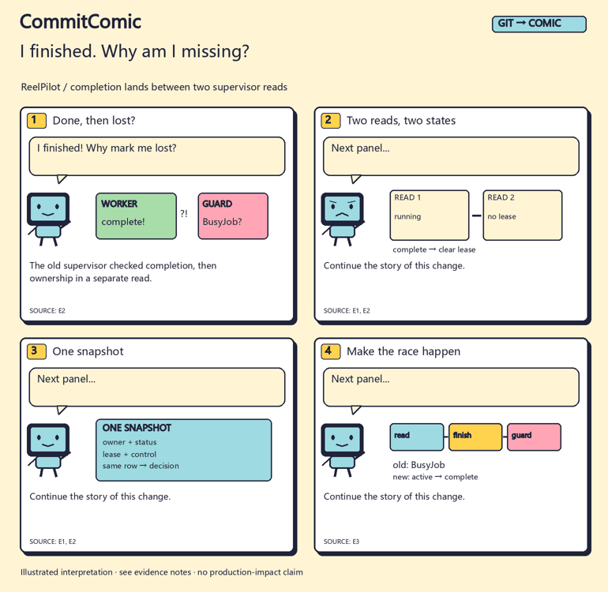

<div align="center">

# CommitComic

### Your commits have a story.

**An Agent Skill that turns real code changes into development comics and shareable updates.**

[中文](README.zh-CN.md) · [Three real stories](examples/cases/README.md) · [Try one](#try-it-before-pointing-it-at-your-project) · [Skill](SKILL.md)



*From a real ReelPilot correction. [Inspect the pinned source](examples/cases/completion-race/en/evidence.md).*

</div>

The worker finished. The supervisor called it missing. What happened?

That is a better opening than “refactor runtime state validation.” CommitComic helps your Agent find the story inside a real diff, explain it in four beats, and export images plus editable copy.

## Three changes worth explaining

| Story | The interesting part | Read / see |
| --- | --- | --- |
| **I finished. Why am I missing?** | Completion lands between two supervisor reads. The fix decides from one snapshot. | [Comic](examples/cases/completion-race/en/comic.png) · [Source walkthrough](examples/cases/completion-race/README.md) |
| **One line changed. Spare the other three.** | A recorded four-line audio run makes 1 new synthesis call and reuses 3 takes. | [Comic](examples/cases/one-line-edit/en/comic.png) · [Recorded evidence](examples/cases/one-line-edit/README.md) |
| **The file exists. Why no download?** | A process dies after a rename but before SQL commit. The API keeps the uncommitted result behind HTTP 409. | [Comic](examples/cases/publish-gap/en/comic.png) · [Fault record](examples/cases/publish-gap/README.md) |

These are examples from the maintainer's public projects, not customer testimonials. The source experiments are historical; rendering these comics does not rerun the models or fault tests. New readers can open every result without installing anything.

## Install, then ask your Agent

```sh
npx skills add l422145205-source/commit-comic --skill commit-comic
```

Example for Codex:

```text
Use $commit-comic on my repository from v0.2.0 to HEAD.
Pick one change worth explaining. Make a light four-panel comic,
a vertical strip and release copy. Read the actual diff first.
Keep the output local and leave unsupported results out.
```

Or start with: **“Use CommitComic to show me the bundled completion-race story.”** Your Agent can render the reviewed example before touching your project. [First-run guide](docs/first-run.md)

The host Agent reads code, chooses the story and writes the dialogue. The bundled Python tools collect the selected committed changes, check source bindings and draw editable vector scenes. They do not need a separate model API or image service.

## What comes out?

| Artifact | Use it for |
| --- | --- |
| **Four-panel page** · SVG + optional PNG | README updates, devlogs and explanations |
| **Vertical strip** · SVG + optional PNG | Phone reading and long-form posts |
| **Square share card** · SVG + optional PNG | A cover with the story's hook |
| **Panel-reveal GIF** · optional | A quick illustrated preview |
| **Post + alt text + source notes** | Editable copy and evidence readers can follow |

[See the complete export set](examples/cases/README.md). Built-in scenes now include supervisor races, snapshots, audio takes, fingerprints, ASR checks, publication gaps and recovery, alongside the original coder, note and bug scenes. `pop` and `night` palettes are available. These are vector templates, not an arbitrary-art image model.

## Why install this instead of asking once?

You get the same reusable path next time: selected Git range → reviewed story → several image formats → a local edition record. The collector uses **net changes between endpoints**, so an old `feat:` title alone cannot turn reverted work into a shipped feature. Each panel keeps its source IDs; supplied check results stay separate from authored interpretation.

A normal chat with equivalent rules and tools can do the task too. The Skill packages them so you do not need to rebuild that workflow for every update. It does not post for you or promise an audience.

## Try it before pointing it at your project

Download the repository, then run from its directory with Python 3.10+:

```sh
python scripts/commitcomic.py demo --case completion-race --out work/first-comic
```

Open `work/first-comic/comic.svg`. This path needs **no Git, model, API key, network or third-party Python package**. Use a fresh output directory each time.

For PNGs and GIF:

```sh
python -m pip install -r requirements-images.txt
python scripts/commitcomic.py demo --case one-line-edit --out work/audio-comic --images
```

Other cases: `publish-gap` and `moonnotes`. Add `--locale zh` for Chinese; raster output needs a local CJK font, optionally supplied with `--font`. [Full workflow and dependencies](references/workflow.md)

## Tell us where it stopped being useful

Did the first panel make sense? Did the source-to-story step need too much rewriting? Could you generate one output from your own change?

[Leave a short try-out report](https://github.com/l422145205-source/commit-comic/issues/new?template=try-it.yml). A public, redacted input description and the point where you got stuck are enough; there is no need to share private code or personal information. If the tool is useful to you, a Star makes it easy to find again.

<details>
<summary><strong>Technical checks, source scope and contribution guide</strong></summary>

The tool suite contains **28 tests**. [Windows / Linux CI](https://github.com/l422145205-source/commit-comic/actions) runs them, the original synthetic Git demonstration and image rendering for all three real-project stories. The synthetic MoonNotes fixture has its own 4 checks; those are a separate count.

Source IDs and hashes bind an illustration to its input, but do not prove the interpretation correct. The Agent still reviews the code and the claim. Common-pattern redaction is an aid, not complete disclosure review; accompanying source notes may contain code. Helpers leave the source working tree unchanged and never publish automatically.

[Skill workflow](SKILL.md) · [Format](references/format.md) · [Reproduce](tools/README.md) · [Design evidence](references/design-evidence.md) · [Contribute](CONTRIBUTING.md)

</details>

[MIT License](LICENSE). Original vector art, code and reviewed example boards are included.
