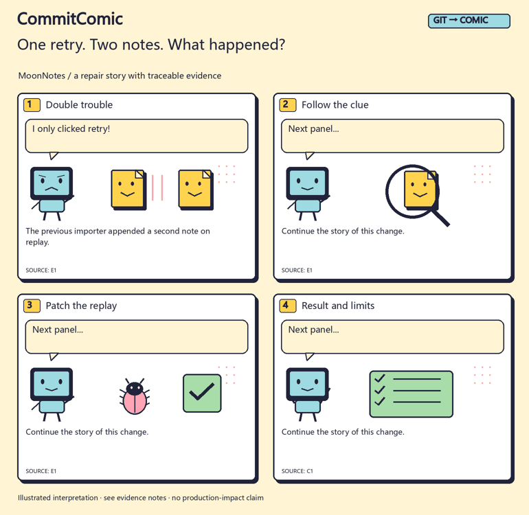
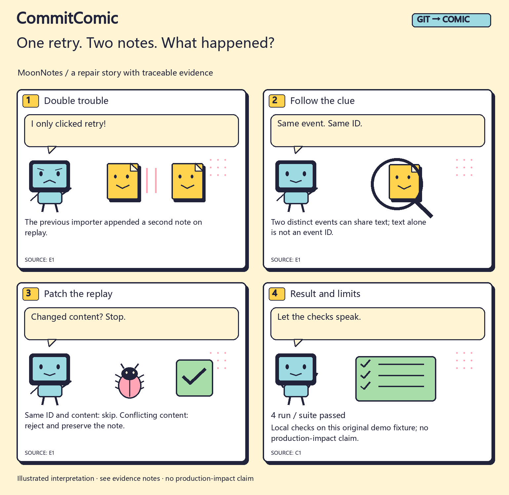

<div align="center">

# CommitComic

### You fixed the bug. Now tell the story.

**An Agent Skill that turns real Git changes into source-linked development comics.**

[中文](README.md) · [Worked example](examples/README.md) · [Skill entry](SKILL.md) · [Reproduce it](tools/README.md)



*Original synthetic MoonNotes project; actual Git collection, four local tests and render outputs. This is a comic reveal, not an application recording.*

</div>

Your Git log says `fix`, `refactor`, `test`. Your reader wants a different answer: **what happened, what was tricky, and what changed?**

Ask your Agent to find one real story in the diff. CommitComic supplies the repeatable path from that evidence to four readable panels, a vertical strip, a share card and editable release copy.

## One retry. Two notes. What happened?

The demo importer used to append another note on replay. The clue: two different events can contain the same text. The fix needs event identity, plus a conflict rule that preserves existing content.



[Inspect the sources](examples/en/evidence.md) · [Storyboard JSON](assets/board.en.example.json) · [Chinese version](examples/zh/comic.png)

## Why install a Skill?

A regular chat can write a storyboard too. This packages the reusable workflow and its tools:

| Step | What you get |
| --- | --- |
| Find the actual change | Read-only collection of a selected Git range, using endpoint net diffs rather than treating commit titles as proof |
| Make it readable | An Agent-authored problem → clue → change → result story, with short dialogue and technical captions |
| Keep the source nearby | Evidence IDs, an exact packet hash, literal-quote checks and scoped check records |
| Export once | Editable SVGs; optional PNGs and GIF; a vertical strip, square card, post, alt text and evidence notes |
| Continue next time | A local edition ledger that remembers the prior head and treats exact repeated records as no-ops |

No promise of virality. The purpose is to make real work easier to explain and share.

## Use it for

- **Bug-fix stories:** a surprising old behavior, the useful clue, the change and a supported result.
- **Release highlights:** one approachable story, with full scope kept in accompanying notes.
- **Technical lessons:** an original example for idempotency, validation or cache behavior.
- **Team handoffs:** a visual explanation of why the code changed, with source details to follow.

## Install and ask

```sh
npx skills add l422145205-source/commit-comic --skill commit-comic
```

Or download the repository and load its complete directory through your Agent host. The entry is [SKILL.md](SKILL.md). Local Git and Python 3.10+ are required. SVG/text export uses the standard library; PNG/GIF adds the optional Pillow dependency and suitable local fonts.

Example for Codex:

```text
Use $commit-comic on this repository from v0.2.0 to HEAD.
Pick one bug fix and make an approachable English four-panel comic.
Include a vertical strip, share card and post. Keep claims grounded
in the diff and available check results. Save locally first.
```

Or: “Use CommitComic for this week's devlog. Explain one highlight to someone seeing the project for the first time.”

The host Agent selects the story, understands the code and writes the words. The helpers collect, validate and render. They need no model/image API, make no network requests and publish nothing.

## One story, several formats

| File | Format | Example |
| --- | --- | --- |
| `comic.svg / .png` | 1540×1500 four-panel page | [Open](examples/en/comic.png) |
| `strip.svg / .png` | 1000×2920 vertical strip | [Open](examples/en/strip.png) |
| `card.svg / .png` | 1200×1200 share card | [Open](examples/en/card.png) |
| `preview.gif` | Sequential panel reveal | [Open](examples/en/preview.gif) |
| `post.md` | Editable copy | [Read](examples/en/post.md) |
| `evidence.md / manifest.json` | Scope, sources and artifact hashes | [Sources](examples/en/evidence.md) · [Manifest](examples/en/manifest.json) |

Built-in `pop` and `night` palettes use four original vector scenes with a monitor-headed coder, notes and a bug. These are deterministic, editable templates rather than arbitrary image-model art.

## Try the complete demo

From a downloaded checkout, use a new output directory:

```sh
python tools/reproduce.py --out work/my-demo --locale en
```

For PNGs and the GIF:

```sh
python -m pip install -r requirements-images.txt
python tools/reproduce.py --out work/my-image-demo --locale en --images
```

`--locale both` adds Chinese. Chinese raster output needs a local CJK font, optionally supplied with `--font`. Fonts are not downloaded or bundled. See [the reproduction guide](tools/README.md).

## Interesting, and accountable

Reverted work is not presented as a shipped feature merely because an old commit said `feat:`. Source IDs and hashes establish a binding; they do not certify that the interpretation is semantically correct. The Agent still reviews source context and distinguishes a demo check from a production result.

Common-pattern masking and sensitive-path exclusions are aids, not complete disclosure review. Evidence notes can contain code. Review all artifacts before sharing private material. The tools do not run arbitrary project tests, modify the source working tree or infer deployment impact.

## Checks

**24 tool tests** cover net diffs and reverts, file handling, redaction patterns, source binding, check summaries, artifact hashes and edition continuity. The original fixture runs **4 actual local tests**. Both language outputs have been rendered and inspected; [CI](https://github.com/l422145205-source/commit-comic/actions) runs tests and the English image workflow on Linux and Windows.

These checks are not an Agent benchmark or an engagement study. [Design evidence](references/design-evidence.md) records the source material and limits.

If this helps explain your next change, a Star makes it easy to find again. Contributions of original scenes, font fixes or public, redacted worked examples are welcome. Please keep personal data, private logs and secrets out of submissions.

[MIT License](LICENSE) · Original code, vector characters and synthetic examples are included.
