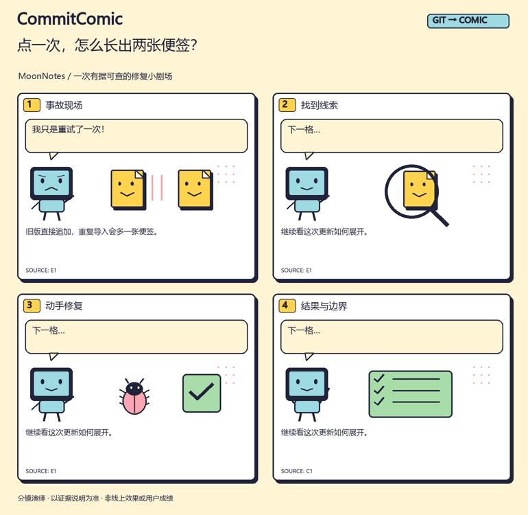
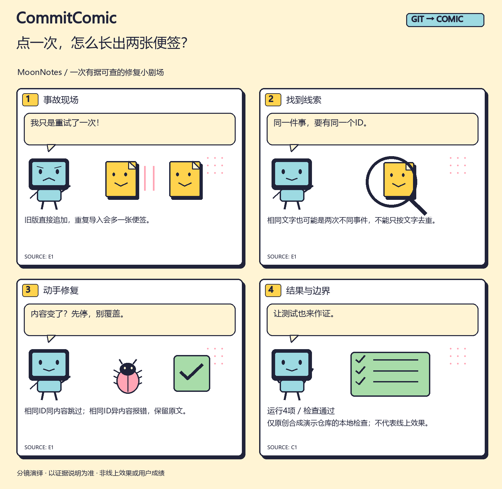

<div align="center">

# CommitComic

### 你修了一晚上的 Bug，值得一个好故事。

**把真实 Git 改动，变成有出处的四格开发漫画。**

[English](README.en.md) · [看看完整案例](examples/README.md) · [Skill 入口](SKILL.md) · [复现流程](tools/README.md)



*原创合成项目 MoonNotes；实际 Git 差异、4 项本地测试和渲染工具产物。动画是漫画逐格预览。*

</div>

> 周五，你想发条项目动态。Git 日志里全是 `fix`、`refactor` 和 `test`。你知道自己做了很多，读者却还不知道：**发生了什么？难点在哪？最后改好了什么？**
>
> 告诉 Agent：“用 CommitComic，把这次修改讲成一个开发小剧场。”

## 从“修复了重复导入”，到“我只是重试了一次！”

一个便签导入器，重试一次就多出一张便签。故事里有事故、有线索，也有容易忽略的细节：两次不同事件可以拥有相同文字，不能一股脑按内容去重。

CommitComic 让 Agent 读实际改动，挑出一条值得讲的线索，再用短对话和原创角色解释它。技术细节放进图注，来源放进随附说明。



[查看这一期的 Git 证据](examples/zh/evidence.md) · [分镜 JSON](assets/board.zh.example.json) · [英文版](examples/en/comic.png)

## 装上这个 Skill，多了什么？

一次普通聊天也能写漫画脚本。安装的意义，是把**选题、读代码、分镜、出图、下一期接续**变成可复用的 Agent 工作流程。

| 环节 | CommitComic 提供的东西 |
| --- | --- |
| 先弄清改了什么 | 只读指定 Git 范围；看两个端点的净差异，提交标题只作为线索 |
| 把技术讲成人话 | 问题 → 线索 → 改动 → 结果四拍叙事；由宿主 Agent 理解和改写 |
| 图里说的话有出处 | 每格引用来源 ID；分镜绑定证据哈希；引用原文与检查摘要有独立规则 |
| 一次写好，多处使用 | 四格页、竖版长图、方形分享卡、逐格 GIF、配文、替代文本一起导出 |
| 下周继续更新 | 本地期号记录保留上次 Git 端点；同一期重复记录不会新增一条 |

这里没有“装上就涨粉”的承诺。它解决的是：**把你做过的东西，讲得更容易看懂、拿出去分享。**

## 可以用在哪些时刻？

**🐛 今天的 Bug 有点离谱。** 让 Agent 从旧行为、修复逻辑和可用检查里，写出一个短小的修复故事。没有运行日志时，结果格会保留验证边界。

**🚀 新版本终于发布。** 从一批改动里挑一个亮点，做成适合 README、开发日志或动态的漫画；完整变更范围留在文字里。

**🧩 一个技术点，解释三次了。** 用原创示例讲幂等、缓存失效、输入校验等概念，把“术语解释”换成“角色遇到了什么”。

**📚 给队友介绍这段修改。** 一张图讲明白为什么改，证据说明保留具体代码，读者可以往下追。

## 安装，接着对 Agent 说话

在支持 Agent Skills 的宿主中，通过 Skills CLI 安装：

```sh
npx skills add l422145205-source/commit-comic --skill commit-comic
```

也可以下载本仓库，将其作为一个完整 Skill 目录交给宿主加载；入口是根目录的 [SKILL.md](SKILL.md)。使用前需要本地 Git 和 Python 3.10+。默认 SVG/文字输出仅使用 Python 标准库；PNG/GIF 另需可选的 Pillow 和相应语言字体。

给 Codex 的示例指令：

```text
用 $commit-comic 读当前项目 v0.2.0 到 HEAD 的已提交修改。
选一个最容易讲明白的修复，做成中文四格开发漫画，语气轻松。
给我竖版、分享卡和配文；没有证据的效果不要补写。先保留在本地。
```

也可以这样开始：

```text
用 CommitComic 把本周的提交做一期英文开发日志。
面向第一次看到项目的人，只讲一个亮点，附来源说明。
```

```text
用 CommitComic 解释这次缓存逻辑修改。
先读改动，再写分镜。图中不要出现项目内部名称或代码原文。
```

宿主 Agent 负责选题、理解与文案；脚本负责可重复的采集、校验和绘制。工具自己不联网、不调用图像模型，也不发布内容。

## 同一个故事，不止一张图

| 产物 | 用途 | 示例 |
| --- | --- | --- |
| `comic.svg / .png` | 1540×1500 四格页，README 和技术分享 | [中文](examples/zh/comic.png) · [English](examples/en/comic.png) |
| `strip.svg / .png` | 1000×2920 竖版，手机阅读或开发日志 | [看长图](examples/zh/strip.png) |
| `card.svg / .png` | 1200×1200 方形封面 | [看分享卡](examples/zh/card.png) |
| `preview.gif` | 分镜渐进预览 | [中文](examples/zh/preview.gif) · [English](examples/en/preview.gif) |
| `post.md` | 可继续编辑的发布配文 | [看配文](examples/zh/post.md) |
| `evidence.md / manifest.json` | 来源范围、对应关系和文件哈希 | [来源](examples/zh/evidence.md) · [清单](examples/zh/manifest.json) |

SVG 可编辑。内置 `pop`、`night` 两种配色，以及显示器程序员、便签、小虫组成的四类原创矢量场景；不是任意画风的文生图模型。

<details>
<summary><strong>无需 Agent，也能先跑完整演示</strong></summary>

从下载后的仓库目录运行，输出位置必须是尚不存在的新目录：

```sh
python tools/reproduce.py --out work/my-demo --locale both
```

上面生成可编辑 SVG 和文字。需要 PNG/GIF 时，在自己的 Python 环境安装可选依赖：

```sh
python -m pip install -r requirements-images.txt
python tools/reproduce.py --out work/my-image-demo --locale en --images
```

中文图片可用 `--locale zh` 或 `both`；需要本地 CJK 字体，必要时用 `--font /path/to/local-cjk-font.ttc` 指定。工具不下载或打包字体。

演示实际创建一个原创 Git 仓库、执行 4 项小型用例、采集差异、渲染漫画并检查重复期号。详见 [复现说明](tools/README.md)。

</details>

## 有趣，也要对得上代码

比较的是指定端点的**净差异**，因此“写过又撤回”的功能不会仅凭旧提交标题成为上线成果。每格的来源绑定可以机械校验，解释是否忠实仍需 Agent 阅读源码；有效的 ID 不代表因果关系已经证明。

内置常见隐私模式遮罩和部分敏感文件排除。公开前仍要检查图片、配文和证据说明，尤其后者可能包含代码。辅助工具不执行任意项目测试、不改工作区、不自动上传，也不会从提交信息猜测线上收益。

## 当前验证

- **24 项工具测试**：净差异/回退、文件重命名、隐私模式、缺失来源、输入绑定、检查日志、输出哈希、期号续接等。
- **4 项原创示例用例**：同事件重试、冲突保护、同文不同事件、缺失 ID。
- 已生成并检查中英文图文；[CI](https://github.com/l422145205-source/commit-comic/actions) 在 Linux / Windows 运行测试及完整英文演示。

这些是工具行为与合成案例检查，不是传播效果或宿主 Agent 性能评测。[设计依据与边界](references/design-evidence.md) 记录了资料来源和取舍。

## 一起把下一期做得更好

如果它让你的更新更好讲，欢迎 Star 留作下次使用。也欢迎带一个**可公开、已去敏的改动案例**来讨论：最难讲清的是哪一步？什么分镜让读者突然理解了？

新增场景、字体适配和好玩的叙事示例都欢迎。请勿提交私有项目日志、个人资料或密钥。

[MIT License](LICENSE) · 原创代码、矢量角色和合成示例随仓库一起提供。
