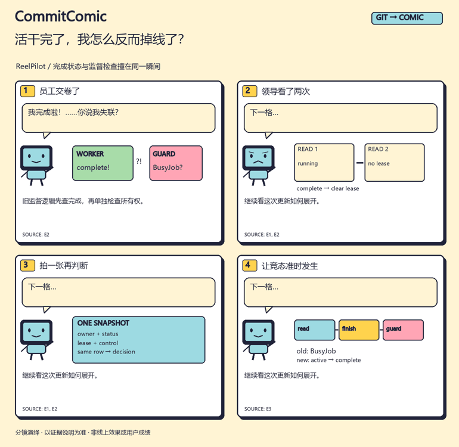

<div align="center">

# CommitComic

### 代码更新，也值得一个好故事。

**把真实项目改动，讲成四格开发漫画，顺手带走长图、封面和发布配文。**

[English](README.md) · [三个真实案例](examples/cases/README.md) · [先试一次](#先试一次再处理自己的项目) · [Skill 入口](SKILL.md)



*来自 ReelPilot 的实际修复。[对应提交与来源](examples/cases/completion-race/zh/evidence.md)*

</div>

“Agent 明明干完活了，为什么却被判失联？”

这比“重构运行时状态校验”更容易让人想往下看。CommitComic 让 Agent 先读改动，找到值得解释的那个瞬间，再把问题、线索、修改和结果画成一小段故事。

## 先看三个真的发生过的故事

| 故事 | 值得讲清楚的地方 | 直接看 |
| --- | --- | --- |
| **活干完了，我怎么反而掉线了？** | 两次状态读取之间恰好提交完成；改成从同一快照判断。 | [四格漫画](examples/cases/completion-race/zh/comic.png) · [代码讲解](examples/cases/completion-race/README.md) |
| **只改一句，另外三句别加班。** | 四句配音只改第一句，历史实测新增1次合成、复用3句。 | [四格漫画](examples/cases/one-line-edit/zh/comic.png) · [实测出处](examples/cases/one-line-edit/README.md) |
| **文件都在了，为什么还不给下载？** | 文件重命名之后、SQL提交之前进程死亡；未提交结果返回409。 | [四格漫画](examples/cases/publish-gap/zh/comic.png) · [故障记录](examples/cases/publish-gap/README.md) |

案例来自维护者自己的公开项目，不是外部用户评价。漫画依据固定提交和已有实测记录制作；本轮绘制没有重跑语音模型或历史故障实验。不安装，也可以直接打开全部成果。

## 装好后，对 Agent 说一句

```sh
npx skills add l422145205-source/commit-comic --skill commit-comic
```

给 Codex 的例子：

```text
用 $commit-comic 读当前项目 v0.2.0 到 HEAD 的已提交修改。
选一个值得讲的变化，做成中文四格漫画、竖版长图和发布配文。
语气轻松，先看实际差异，没依据的效果别补写，先保存在本地。
```

也可以先说：**“用 CommitComic 给我看一下自带的‘完成却失联’案例。”** 先出一张图，再处理自己的代码。[第一次使用指南](docs/first-run.md)

宿主 Agent 负责理解代码、挑故事和写对话；工具负责采集、来源绑定与绘制。不需要另接一个图像模型或模型 API。

## 一次写好，带走这些

| 成果 | 可以放在哪里 |
| --- | --- |
| **四格漫画** · SVG / 可选PNG | README、开发日志、技术说明 |
| **竖版长图** · SVG / 可选PNG | 手机阅读、图文帖子 |
| **方形封面** · SVG / 可选PNG | 项目动态和文章封面 |
| **逐格GIF** · 可选 | 快速预览故事 |
| **配文、替代文本、来源说明** | 继续编辑发布，也让读者追到代码 |

[查看完整导出](examples/cases/README.md)。除了程序员、便签和小虫，还增加了监督竞态、状态快照、音频片段、合成指纹、ASR检查、提交间隙与恢复等画面。支持 `pop` / `night` 两种配色，SVG可编辑；内置的是矢量场景模板。

## 安装这个 Skill，省在哪里？

下一次更新可以继续沿用：指定提交范围 → 选题和分镜 → 多种图文格式 → 本地期号记录。采集看两个端点的**净差异**，避免把已经撤回的功能，仅凭旧提交标题讲成上线成果。每格带来源ID，检查记录与作者解释分开。

普通聊天在给足规则和工具后也能完成。安装的价值，是不用每次重新拼这套工作流程。它不会自动发帖，也不保证涨粉。

## 先试一次，再处理自己的项目

下载仓库后，在目录内用 Python 3.10+ 运行：

```sh
python scripts/commitcomic.py demo --case completion-race --locale zh --out work/first-comic
```

打开 `work/first-comic/comic.svg` 即可。这个入口**不需要Git、模型、API Key、网络或额外Python包**。每次使用一个新的输出目录。

需要PNG和GIF时：

```sh
python -m pip install -r requirements-images.txt
python scripts/commitcomic.py demo --case one-line-edit --locale zh --out work/audio-comic --images
```

还可以选 `publish-gap`、`moonnotes`。中文图片需要本地CJK字体，必要时用 `--font` 指定。[完整流程与依赖](references/workflow.md)

## 看完图，最想知道你卡在哪

第一格能否看懂？把源码变成故事时，哪里还需要大量重写？用自己的改动，能不能顺利出一份结果？

[留一条简短试用反馈](https://github.com/l422145205-source/commit-comic/issues/new?template=try-it.yml)：写清公开、去敏后的输入类型和卡住的位置即可，不用提交私有代码或个人资料。觉得下次用得上，欢迎Star留作书签。

<details>
<summary><strong>技术验证、来源边界与贡献说明</strong></summary>

工具共 **28项测试**。[Windows / Linux CI](https://github.com/l422145205-source/commit-comic/actions)运行测试、原创合成Git演示，以及三个真实案例的英文图片渲染。MoonNotes原创小例子另有4项用例，不与工具测试混算。

来源ID和哈希确认输入关联，解释是否忠实仍需Agent读代码核对。常见隐私模式遮罩不替代公开前审阅，来源说明可能包含代码。辅助工具不改源码工作区、不自动发布。

[Skill流程](SKILL.md) · [输入格式](references/format.md) · [复现说明](tools/README.md) · [设计依据](references/design-evidence.md) · [参与贡献](CONTRIBUTING.md)

</details>

[MIT License](LICENSE)。原创矢量素材、代码和已审阅分镜随仓库提供。
