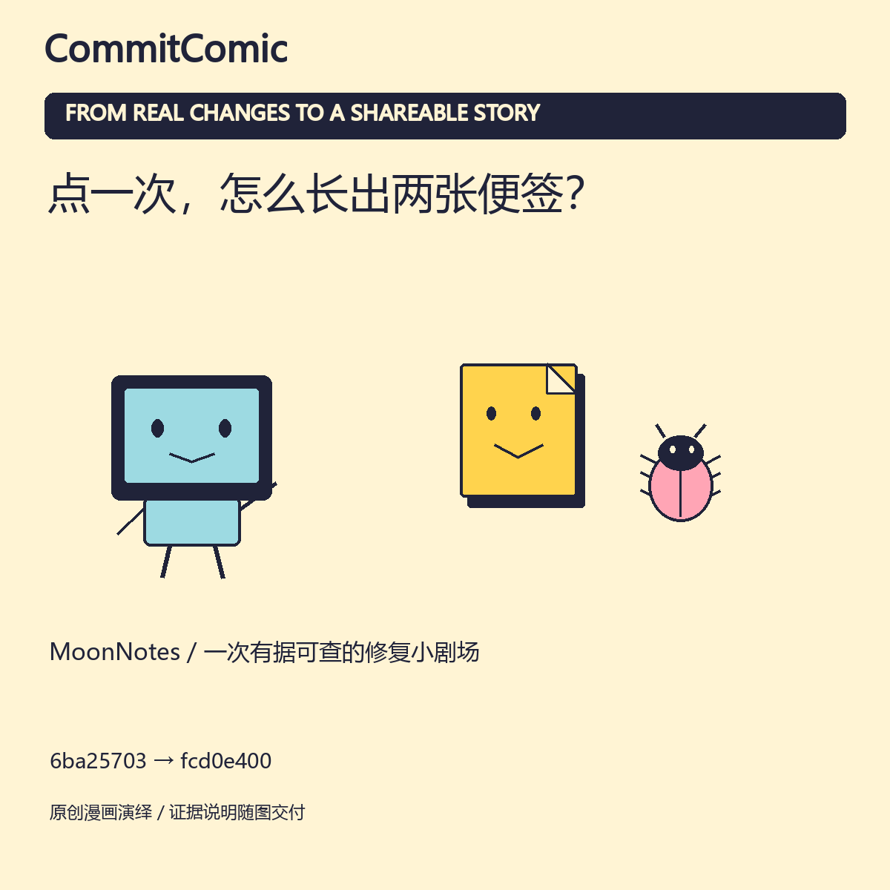

# 一次修改，怎样成为一期漫画？

想先看实际项目改动？[三个真实工程故事](cases/README.md)提供中英文漫画、来源与说明。下面保留原创合成MoonNotes案例，方便从零复现Git和检查流程。

本案例的 MoonNotes 是原创虚构项目；提交、差异、4 项本地测试、渲染与期号重放都由 [复现脚本](../tools/reproduce.py) 实际执行。它不是用户项目案例或线上成功故事。

## 输入

便签导入器最初直接追加；修改后用事件 ID 区分重试与不同事件，同 ID 的冲突内容会报错并保留原记录。

- [证据包](../assets/packet.example.json)：2 份净差异，1 份检查摘要。
- [中文分镜](../assets/board.zh.example.json) / [English storyboard](../assets/board.en.example.json)：每格绑定来源，最后一格引用检查记录。
- [实际复现记录](verification.json)：4 项用例运行通过；同一期重复记录没有新增条目。

证据包里的提交属于本地合成仓库，不是本仓库的历史提交链接。可按 [tools/README.md](../tools/README.md) 重建它们。测试日志原文在复现目录生成；公开示例只保留摘要与原日志哈希。

## 输出

|  | 中文 | English |
| --- | --- | --- |
| 四格 | [PNG](zh/comic.png) · [SVG](zh/comic.svg) | [PNG](en/comic.png) · [SVG](en/comic.svg) |
| 长图 | [PNG](zh/strip.png) · [SVG](zh/strip.svg) | [PNG](en/strip.png) · [SVG](en/strip.svg) |
| 方形卡 | [PNG](zh/card.png) · [SVG](zh/card.svg) | [PNG](en/card.png) · [SVG](en/card.svg) |
| 动画 | [GIF](zh/preview.gif) | [GIF](en/preview.gif) |
| 配文 | [Markdown](zh/post.md) | [Markdown](en/post.md) |
| 来源 | [证据说明](zh/evidence.md) | [Evidence notes](en/evidence.md) |
| 替代文本 | [Text](zh/alt-text.txt) | [Text](en/alt-text.txt) |
| 哈希清单 | [JSON](zh/manifest.json) | [JSON](en/manifest.json) |

图片是对代码的漫画化解释，GIF 是逐格揭示；都不是应用运行截图。分镜通过结构和来源检查，不表示语义已经自动证明。例子的 4 项用例与工具本身的 24 项测试分开计数。
