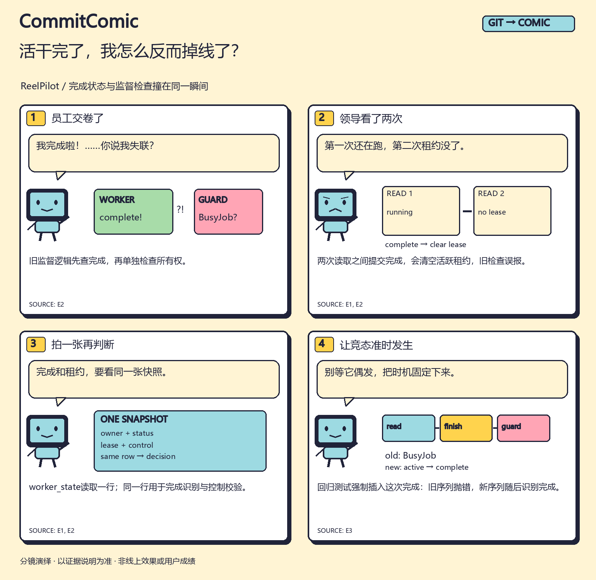

# 活干完了，我怎么反而掉线了？ / I finished. Why am I missing?

[English comic](en/comic.png) · [竖版](zh/strip.png) · [分享卡](zh/card.png) · [配文](zh/post.md) · [来源说明](zh/evidence.md)

监督器要判断：worker是在继续工作，还是已经完成？原实现先调用 `completed_by_self()`，没看到完成就再调用 `guard()`。两个方法分别查询数据库。

问题出在两次查询的间隙：worker恰好提交完成，清空活跃租约。第一次看见“还没完成”，第二次却因为租约失效而抛 `BusyJob`。这时结果其实已经有效提交。

修复新增 `worker_state()`：读取包含owner、status、lease和控制字段的同一行快照；先识别自己提交的完成，否则对这行执行控制校验。它没有冻结worker的整个生命周期；下一次轮询仍然可能看到新的完成状态。

## 可以追到哪里？

- [实际修复提交](https://github.com/l422145205-source/reelpilot/commit/b73e054995e373de35a9d40a96ea5c86e5420a8a)
- [固定版本的回归测试](https://github.com/l422145205-source/reelpilot/blob/b73e054995e373de35a9d40a96ea5c86e5420a8a/tests/test_runtime_control.py)：`test_supervisor_completion_race_uses_one_state_snapshot` 强制在第一次读取之后提交完成，比较旧两次读取与新单快照序列。
- [本漫画证据包](../../../assets/cases/completion-race/packet.json) · [中文分镜](../../../assets/cases/completion-race/board.zh.json)

漫画依据真实提交与回归代码制作，本次没有重新运行ReelPilot测试。它解释的是具体时序下的修复，不是对所有并发调度的证明。

**English:** The old supervisor combined a completion read with a separate ownership read. Completion in between could clear the active lease and make the second check raise. The correction decides from one snapshot. A deterministic regression injects the transition instead of waiting for it to occur randomly.

想用同样方法解释自己的修复？[第一次使用](../../../docs/first-run.md)。如果看完仍不明白旧序列错在哪，欢迎在试用反馈里指出哪一格需要改。
