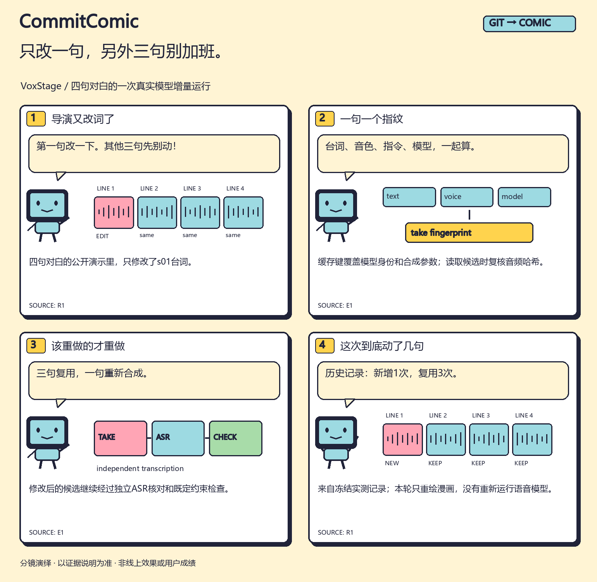

# 只改一句，另外三句别加班。 / One line changed. Spare the other three.



[English comic](en/comic.png) · [竖版](zh/strip.png) · [分享卡](zh/card.png) · [配文](zh/post.md) · [来源说明](zh/evidence.md)

VoxStage的公开案例有四句中文角色对白。一次修改把第一句 `s01` 从“指挥官，飞船已经准备好了。”改成“指挥官，所有乘客已经登船。”，另外三句文本保持一致。

合成缓存使用模型身份、台词、语言、音色、指令和seed等参数计算指纹；候选文件还需通过哈希复核。修改后的台词生成新候选，再按既定流程进行独立ASR与约束检查。复用其余候选，不代表把新台词的检查省掉。

## 已有实测记录说了什么？

固定报告的 `showcases` 中，`spaceport` 的 `one_line_edit.stats` 为：

```json
{"tts_calls": 1, "asr_calls": 1, "tts_cache_hits": 3, "asr_cache_hits": 7}
```

这些是该次历史运行的调用/命中计数，不是一般化的性能提升百分比，也不是主观音质评价。本轮只重新绘制图文，没有加载或运行语音模型。

- [固定实验报告](https://github.com/l422145205-source/voxstage/blob/0e8443a8e3486215a91198e4b2beb4ec6525f792/reports/production_pilot.json)
- [当时的实现](https://github.com/l422145205-source/voxstage/blob/0e8443a8e3486215a91198e4b2beb4ec6525f792/src/voxstage/director.py)
- [本漫画证据包](../../../assets/cases/one-line-edit/packet.json) · [中文分镜](../../../assets/cases/one-line-edit/board.zh.json)

**English:** In the recorded four-line scene, only cue `s01` changed. The historical run made one new TTS call and reused three takes. Cache identity includes synthesis parameters and model identity; the changed candidate still passes through independent transcription and configured checks. The record is not a claim about acting quality or general speedup.

想把自己的优化讲成这个长度？[第一次使用](../../../docs/first-run.md)。欢迎反馈“读完能否解释为什么另外三句能复用”。
