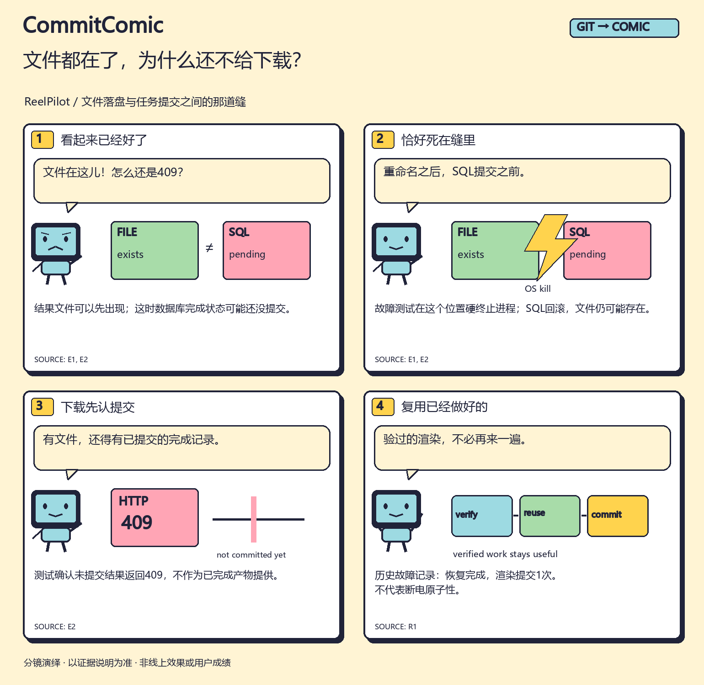

# 文件都在了，为什么还不给下载？ / The file exists. Why no download?

[English comic](en/comic.png) · [竖版](zh/strip.png) · [分享卡](zh/card.png) · [配文](zh/post.md) · [来源说明](zh/evidence.md)

`Journal.finalize()`在SQLite写事务内替换最终结果清单，再提交完成状态。但文件系统重命名不能被SQLite回滚：如果进程在重命名之后、SQL提交之前死亡，文件可能留下，数据库却仍未确认完成。

ReelPilot的下载接口要求持久化的完成决定。对应故障测试会在这个位置硬终止进程，确认未提交结果返回HTTP 409，再等请求租约真实过期后恢复。已经验证的渲染阶段可以复用。

## 已有故障记录说了什么？

公开报告中 `result_replaced_before_commit` 案例记录：OS hard kill、`uncommitted_result_served: false`、恢复后 `status: complete`、`render_commits: 1`。

这说明该次进程故障实验保留了下载门槛并复用了渲染；不表示文件系统和数据库具备断电原子性。本轮漫画制作没有重新执行这个故障实验。

- [固定版本的finalize实现](https://github.com/l422145205-source/reelpilot/blob/ba3d650556124b206682ee2eec361148f52fb779/src/reelpilot/journal.py)
- [真实进程故障测试](https://github.com/l422145205-source/reelpilot/blob/ba3d650556124b206682ee2eec361148f52fb779/tests/test_process_runtime.py)：`test_hard_kill_recovers_verified_render_without_serving_uncommitted_result`
- [固定故障报告](https://github.com/l422145205-source/reelpilot/blob/ba3d650556124b206682ee2eec361148f52fb779/reports/runtime_fault_validation.json)
- [本漫画证据包](../../../assets/cases/publish-gap/packet.json) · [中文分镜](../../../assets/cases/publish-gap/board.zh.json)

**English:** A rename can leave a result file present even when the surrounding SQL transaction never commits. The API serves only a committed completion. The recorded OS-kill case rejects the uncommitted output, then recovers with a single render commit. This is process-crash recovery, not a power-loss transaction guarantee.

[第一次使用](../../../docs/first-run.md)。如果你也有一段“看起来完成了，但实际上还差一步”的公开改动，可以用这个叙事结构试一次。
